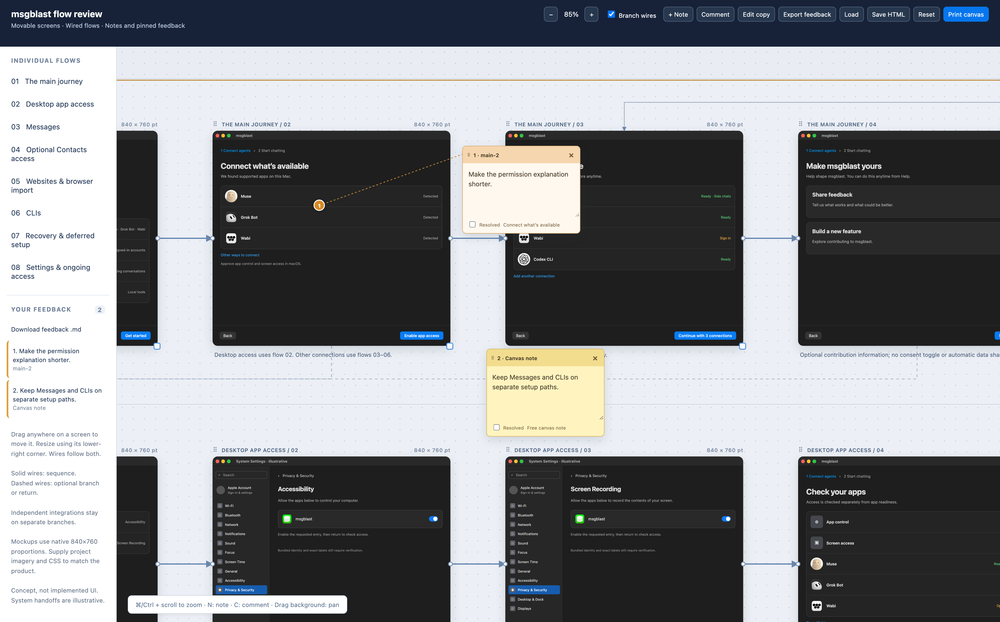
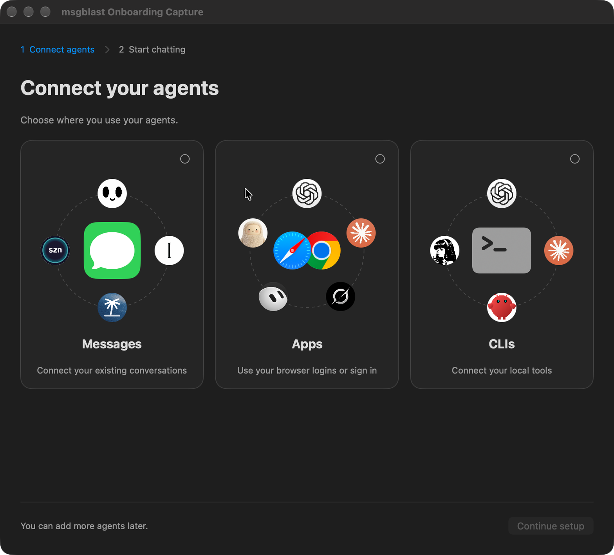
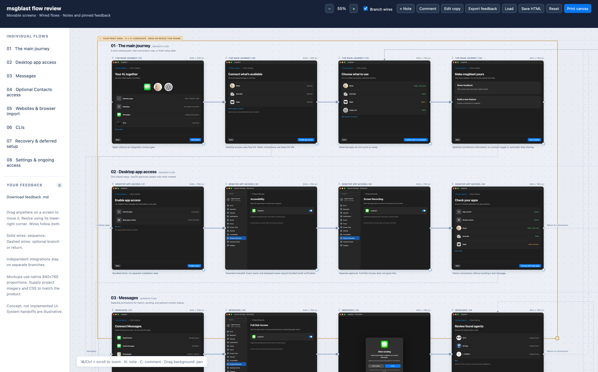
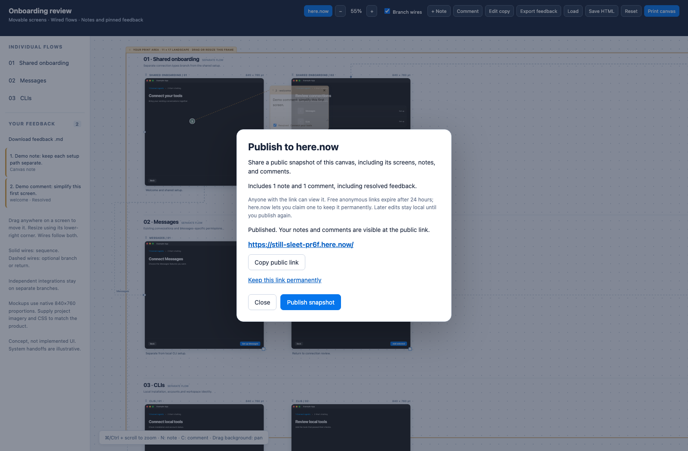

<div align="center">

# Flow Review

**An agent skill that turns UI flows into a canvas you can actually review.**<br>
Move screens. Follow the wires. Leave feedback. Send it back to your agent.

[](https://github.com/mgalpert/flow-review/stargazers)
[](https://github.com/mgalpert/flow-review/actions/workflows/validate.yml)
[](LICENSE)

[Install](#install) · [Why it exists](#why-it-exists) · [What it makes](#what-it-makes) · [Quickstart](#quickstart) · [Publish](#publish-to-herenow) · [Match your product](#match-your-product) · [Feedback](#the-feedback-loop) · [Contributing](#contributing)

```sh
npx skills add mgalpert/flow-review
```



*The working canvas, using proposed msgblast onboarding screens and sample review comments. These are concept screens, not shipped product UI.*

</div>

Ask your agent in plain words:

- “Map our onboarding from welcome to the first useful action. Keep the different setup paths separate.”
- “Turn these checkout screenshots into a flow review. Show the error and recovery paths too.”
- “Make a canvas of our invite flow that matches the app’s typography, spacing, and icons.”
- “Here’s my exported feedback. Update the screens without losing my comments or arrangement.”

The agent creates one standalone HTML file. Open it in a browser, move things around, and review it together. No account, backend, or canvas subscription required.

---

## Install

Use an agent that supports the [Agent Skills](https://agentskills.io) format:

```sh
npx skills add mgalpert/flow-review
```

The repository contains one skill: **`flow-review-canvas`**. The installer lets you choose the supported agents to install it into. This is a skill, not a separate plugin marketplace or a hosted service.

<details>
<summary><strong>Manual install for Codex or Claude Code</strong></summary>

```sh
git clone https://github.com/mgalpert/flow-review.git

# Codex
mkdir -p ~/.codex/skills
cp -R flow-review/skills/flow-review-canvas ~/.codex/skills/

# Or Claude Code
mkdir -p ~/.claude/skills
cp -R flow-review/skills/flow-review-canvas ~/.claude/skills/
```

Use only the destination for your agent. If a copy already exists, preserve any local edits before replacing it. Reload skill discovery or start a new session if your host needs it.

</details>

In Codex, invoke it explicitly with:

```text
Use $flow-review-canvas to map the onboarding flows for this project.
```

**Requirements:** Python 3.10+ to build a board, and a modern desktop browser to review it. The builder uses only Python’s standard library. Node and Playwright are development/test tools, not runtime requirements.

## Why it exists

Flow Review was made while building [msgblast](https://msgblast.app), a native Mac app for comparing AI answers across your existing apps, websites, Messages conversations, and local tools.

Reviewing its onboarding exposed a gap between a screenshot sheet and a useful design conversation. The screens needed wires. Messages and CLIs needed their own flows. The windows needed to look like the actual app. And the person reviewing needed to move, resize, zoom, comment, and send that feedback back to the agent.

This skill packages that workflow so other projects can use it too. It has no dependency on the msgblast codebase.

<details>
<summary><strong>Where it started: native msgblast onboarding</strong></summary>



This is a real native Demo app capture used as a visual reference. Demo accounts and conversations are simulated. The canvas mockups explore proposed changes; this screenshot does not prove those proposals are implemented.

</details>

## What it makes

A local, wired review board with individual screen mockups and explicit paths between them.

| Capability | What you can do |
| --- | --- |
| Wired flows | Follow sequences, optional branches, recovery, and returns |
| Whole-screen dragging | Grab anywhere on a screen to move it |
| Resizable screens | Resize with the lower-right corner; wires follow |
| Canvas navigation | Drag empty space to pan; zoom from 20% to 400% |
| Pinned comments | Point to a specific spot on a screen |
| Free notes | Capture thoughts that apply to the broader flow |
| Feedback export | Copy JSON to your clipboard, or download JSON or readable Markdown |
| Portable saves | Keep the board, imagery, and feedback in one HTML file |
| Public snapshots | Publish the current canvas, notes, and comments to a here.now link |
| Your print layout | Arrange and resize it yourself; print the frame you choose |

Independent flows stay independent. A permissions flow, a billing flow, and a local-tool setup should not become one ambiguous row of screens.



*Canvas captures use example readiness states and illustrative system prompts. Project imagery can be embedded; no third-party icon pack is included in the skill.*

## Quickstart

### With your agent

```text
Use flow-review-canvas to review this project’s onboarding.
Read the current UI first. Match the real window proportions and visual style.
Give each independent setup path its own flow, including recovery and return wires.
I’ll arrange the canvas myself and send you the feedback export.
```

### Without an agent

Clone the repository and build the included starter:

```sh
git clone https://github.com/mgalpert/flow-review.git
cd flow-review
python3 skills/flow-review-canvas/scripts/build_canvas.py --out review.html
```

Open `review.html` in your browser. To author your own flows, copy and edit [the example model](skills/flow-review-canvas/assets/example.json), then build it:

```sh
python3 skills/flow-review-canvas/scripts/build_canvas.py \
  --model my-flows.json \
  --out my-review.html
```

See the [model reference](skills/flow-review-canvas/references/model.md) for screens, positions, wires, imagery, and annotations. Existing output files are protected unless you explicitly pass `--force`.

## Publish to here.now

Open a canvas with the local publishing preview:

```sh
python3 skills/flow-review-canvas/scripts/serve_canvas.py review.html
```

Or build and start the preview in one command by adding `--serve` to the builder.
Open the printed local URL, click **here.now**, then **Publish snapshot**. The
public link includes the current screen copy, layout, imagery, notes, pinned
comments, and resolved feedback. **Copy public link** shares that snapshot.

No account or API key is needed. [here.now](https://here.now/docs) gives anonymous
sites a 24-hour lifetime; use **Keep this link permanently** to claim yours with
a here.now account. Keep that owner link private. It stays separate from the
public canvas and its HTML/feedback exports.

Publishing is explicit. It sends the snapshot to here.now only after you press
**Publish snapshot**. Further edits remain in your browser until you publish
another snapshot; visitors do not edit a shared live database. Offline canvases
still work: **Save HTML** preserves your latest review before starting the
publishing preview. The server uses Python's standard library, serves only the
selected canvas on `127.0.0.1`, and accepts snapshots up to 64 MB. Keep it running
while publishing. Public links remain available after it stops, until their
here.now expiry.



*Actual browser capture using the included example and authored demo feedback.
The real here.now upload was checked in a fresh visitor session. The canvas is a
snapshot; sample screens remain illustrative product mockups.*

[Watch the publishing flow](docs/screenshots/publishing.webm).

## Match your product

The skill asks the agent to inspect your existing UI or supplied screenshots first. Use the real copy, assets, proportions, spacing, and interaction states instead of drawing unrelated generic boxes.

The included renderer starts with native macOS dark styling and 840×760 screen proportions. Adapt the renderer and CSS for a different product or viewport. It does not automatically reproduce arbitrary websites or convert screenshots into editable components.

```sh
python3 skills/flow-review-canvas/scripts/build_canvas.py \
  --model my-flows.json \
  --icons my-icons.json \
  --css my-product.css \
  --out my-review.html
```

Icons are local raster image paths or image data URLs. The builder embeds them in the output. Bring assets you have permission to use; the skill includes no installed-system artwork, project credentials, or private screenshots.

## The feedback loop

1. **Review.** Drag whole screens, resize them, and zoom into details.
2. **Annotate.** Add a note for a general thought, or pin a comment to a screen.
3. **Export.** Click **Copy feedback JSON** in the feedback sidebar to copy the full review, **Export feedback** to download JSON, or download readable Markdown.
4. **Return it.** Paste the copied JSON into your agent conversation, or attach the downloaded file.
5. **Revise.** The agent maps comments to stable screen IDs and updates the board without discarding your arrangement or unresolved feedback.

Copy and download use the same full JSON review, including layout, comments, resolution state, and any imagery embedded in screen bodies. Image-heavy boards can produce large clipboard text. If clipboard access is unavailable or denied, the canvas points you to **Export feedback**; nothing is discarded.

A **comment** belongs to a screen and a relative point on it. Its pin follows movement and resizing. A **note** sits freely on the canvas and describes the wider flow. Both can be edited, moved, marked resolved, and exported.

To rebuild from returned feedback while keeping the previous board’s imagery:

```sh
python3 skills/flow-review-canvas/scripts/build_canvas.py \
  --from-html previous-review.html \
  --model flow-review-feedback.json \
  --out review-v2.html
```

Browser storage saves work locally, but explicit exports are your portable backup. Opening a file directly and serving it on localhost create separate browser-storage contexts. The board does not send your feedback anywhere automatically.

## Canvas controls

| Action | Control |
| --- | --- |
| Move a screen | Drag anywhere on it, or its header |
| Resize a screen | Drag its lower-right blue corner |
| Pan | Drag empty background; Space-drag also works |
| Zoom | +/−, Command/Control-scroll, or trackpad pinch |
| Reset zoom | Command/Control-0 |
| Add a note | **+ Note**, or `N` |
| Pin a comment | **Comment**, or `C`, then click a screen |
| Cancel comment mode | `Esc` |
| Edit screen text | **Edit copy** |
| Copy review JSON | **Copy feedback JSON** in the feedback sidebar |
| Save a portable board | **Save HTML** |
| Print | Arrange the tan frame, then **Print canvas** |

Printing keeps the relative positions, sizes, wires, and notes inside your chosen frame. It does not reflow screens into automatically fitted sheets. The frame maps to an 11×17-inch landscape page; you control what goes inside it.

## Architecture

```text
skills/flow-review-canvas/
  SKILL.md                   Agent workflow and design guidance
  agents/openai.yaml         Skill discovery metadata
  assets/canvas.html         Standalone HTML/CSS/JS engine template
  assets/example.json        Generic starter model
  assets/msgblast-reference.json
  references/model.md        Model, styling, and feedback format
  scripts/build_canvas.py   Standard-library builder
```

Flow and screen data live in JSON. The builder embeds that data and any supplied images in the HTML engine. Browser interactions update positions, sizes, feedback, and camera state. Local review needs no hosted backend or runtime package install. The optional loopback publishing server uploads explicit snapshots to here.now using its create, upload, and finalize API; direct browser publishing is not supported by the service's CORS policy.

[PRIVACY.md](PRIVACY.md) explains local storage and what exports contain.

## When not to use it

Use it for a design discussion, not as proof that the product is implemented or its permissions work. Mockup controls do not send messages, grant system access, or sign in to accounts.

If you only need a short explanation, write one. If you need a maintained system diagram rather than screen-level feedback, a simpler diagram format may be enough.

## Contributing

Useful contributions include better screen renderers, flow examples, accessibility improvements, and fixes to the review/export loop. See [CONTRIBUTING.md](CONTRIBUTING.md) for development checks and screenshot guidance.

## About

Made by [mgalpert](https://github.com/mgalpert), while making [msgblast](https://msgblast.app).

The README’s structure was inspired by [Cathryn Lavery’s diagram-design](https://github.com/cathrynlavery/diagram-design). Flow Review’s canvas engine and skill are separate work; this is not a fork of that project.

[MIT licensed](LICENSE). Supplied project imagery and third-party marks remain subject to their owners’ rights.
